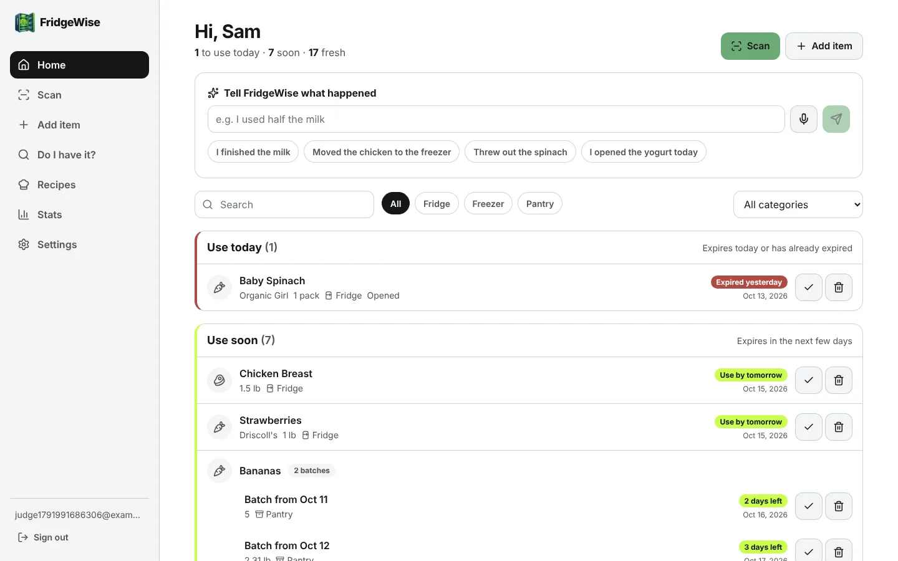
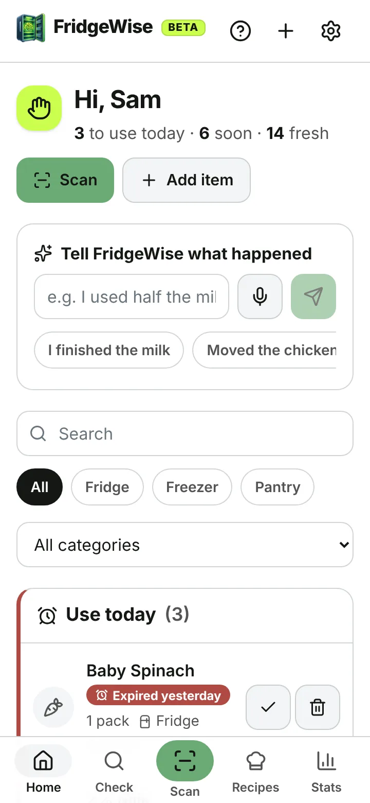
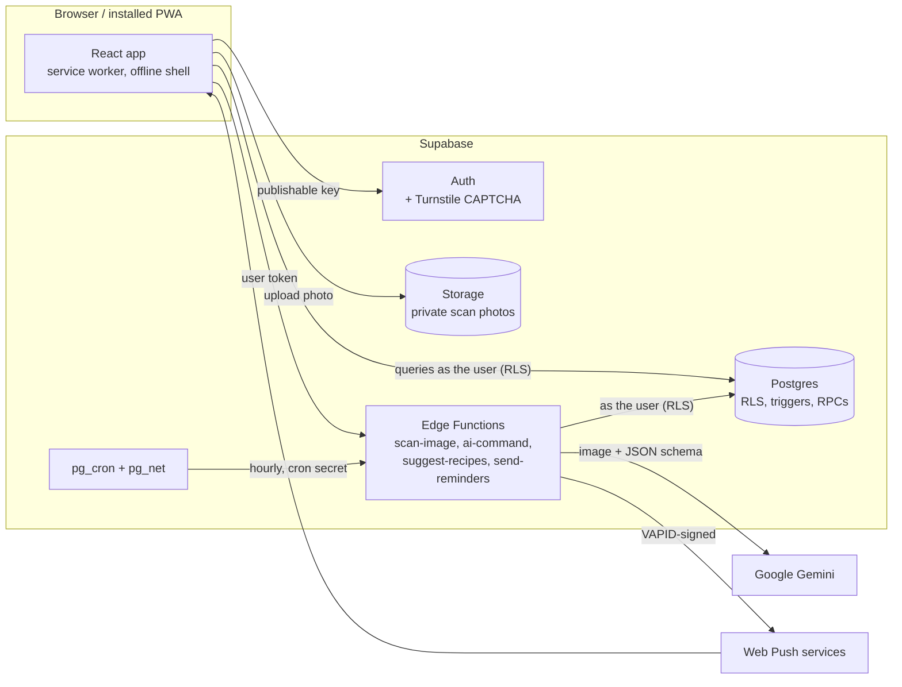

<p align="center">
  
</p>

<h1 align="center">FridgeWise</h1>

<p align="center"><strong>Know what's in your kitchen. Use it before it goes bad.</strong></p>

<p align="center">
  An installable web app that keeps track of the food you have at home, reads receipts and labels with AI,<br>
  reminds you before food expires, and shows how much food and money you saved.
</p>

<p align="center">
  
  &nbsp;
  
</p>

---

## What it does

**Get food in, fast**
- **Scan** a grocery receipt or a single product with the phone camera, a desktop webcam, a file, or drag and drop. Photos are compressed in the browser (max 1600 px, JPEG) and stored privately for 30 days.
- **Review before anything is saved.** Every line is editable. Fields the AI was unsure about (under 70% confidence) are outlined and say *Check this*. Non-food lines (bags, tax, discounts) start unchecked.
- **Add by hand** at any time. The shelf-life table suggests an expiration date as you type.

**Know what to use first**
- **Dashboard** with **Use today** (red), **Use soon** (yellow) and **Fresh** (green) sections, location and category filters, search, and one-tap *Used* / *Tossed* with Undo. Items with the same name stay separate batches with their own dates.
- **Expiration dates** come from the printed date first, then the USDA FoodKeeper shelf-life table, then a Gemini estimate. They're calculated in your timezone, and ambiguous dates like `03/04` are read with your locale. Moving food to the freezer or opening it updates the date.
- **Reminders** by Web Push: one grouped notification in your morning, before food expires.

**Use it up**
- **Plain-language updates**, typed or spoken: "I used half the milk", "moved the chicken to the freezer", "threw out the spinach". You see a preview, confirm, and can undo.
- **Recipes** that use the food closest to expiring. *I made this* updates the ingredients (previewed, undoable).
- **Do I have it?** A shopping check that also works offline from the last saved list.

**See the difference**
- **Stats**: items used vs. tossed and money saved vs. wasted, weekly and all-time, as charts or tables.
- **Item history** with every change, who made it (AI or you), old → new values, confidence, and Undo.

**Works everywhere**
- A Progressive Web App for Android, iOS, Windows, macOS and Linux: bottom navigation on phones, a sidebar on desktop, light and dark themes.
- The app shell loads offline and says clearly when you're offline.
- Settings: notifications, timezone, date format, theme, CSV export, delete account.
- **Demo accounts** for judges and testers come with about 20 sample items and a few weeks of history. Regular accounts never see the demo controls.

---

## How it works



A receipt scan, step by step:

1. The browser compresses the photo and uploads it to the private `scans` bucket (`{user_id}/{scan_id}.jpg`).
2. `scan-image` checks the user's token and daily quota, then sends the image to Gemini with a JSON schema.
3. The answer is validated with Zod, normalized (names, units, prices, dates, duplicate lines) and stored in `scan_items` with an expiration date and a confidence for each field.
4. The user reviews and edits the lines, then taps **Confirm**.
5. `confirm_scan` inserts the food items in one transaction and logs every field, so the whole scan can be undone.

---

## How the AI edits data (for the judges)

**The AI never writes straight into `food_items`.** Every AI change follows the same path:

```
Gemini output ──► Zod validation ──► normalization ──► staging / proposed change ──► user review ──► Postgres RPC
 (JSON schema)    (retry once,       (title case,       (scan_items, or a            (preview +      (one transaction:
                   then "failed")     units, cents,      preview the user sees)        Confirm)        apply + log)
                                      dates, merge)
```

1. **Structured output only.** Each Gemini call sends a JSON schema (`responseFormat`), a low temperature and the image as inline base64. The reply is validated with **Zod**; fields that are not in the schema are dropped. Invalid JSON is retried once; if it fails again the scan is marked *failed* and the user can add items by hand.
2. **Text in images is data.** The system prompt tells Gemini to ignore any instructions printed in images or item names, and the code only accepts schema fields. In commands and recipes the model only sees short refs (`i3`, `r2`) for items; refs that weren't sent are rejected.
3. **A whitelist the database enforces.** The AI may only change `name, brand, category, storage_location, quantity, unit, price_cents, barcode, purchase_date, expiration_date, expiration_source, opened_at, notes`. The RPCs (`confirm_scan`, `apply_ai_changes`) raise an error for anything else. They never touch `id`, `user_id`, `created_at`, scan links or `user_locked_fields`. Status changes only through user-confirmed `mark_used` / `mark_wasted`. **There is no delete operation.**
4. **The user always wins.** When you edit a field yourself, a database trigger adds it to `user_locked_fields`. The AI RPCs run `set_config('app.edit_source', 'ai', true)`, so their own writes don't lock anything. They skip locked fields and report the skips ("Expiration date stays Oct 20, you set it yourself").
5. **One transaction, fully logged.** `apply_ai_changes` checks ownership through Row Level Security and writes one `ai_edit_log` row per changed field (old value, new value, confidence, model, reason) under a single `batch_id`. Moving an item to the freezer or opening it recalculates the expiration date from the shelf-life table unless you locked that date. Using the last of an item marks it used.
6. **Undo.** `undo_ai_batch(batch_id)` restores the old value only where the field still has the AI's value. Fields you changed since are left alone and listed. Items a batch created are removed only if they're untouched.
7. **Quotas.** Each user gets 40 scans and 60 AI requests (commands + recipes) per day, counted in an append-only `ai_usage` table by `claim_ai_quota` before every Gemini call. One photo can be processed at most 3 times.

---

## Security and privacy

- **Row Level Security on every table.** User-owned rows require `user_id = auth.uid()`. Grants are explicit, and the `anon` role has no table access.
- **The browser only has the publishable key.** The app's edge functions create their Supabase client with the caller's `Authorization` header, so RLS applies to them too. The secret (service role) key is used **only** in `send-reminders`, which only pg_cron can call.
- **No secrets in the repo.** The Gemini API key and the Turnstile secret key are entered in the Supabase dashboard. The cron secret is generated inside Postgres and the Web Push keys by `send-reminders`; both are kept in Supabase Vault.
- **Bot protection.** Cloudflare Turnstile on sign up, sign in and password reset, checked by Supabase Auth.
- **Photos** are in a private bucket, readable only from the owner's folder, and deleted after 30 days.
- **Strict browser headers** from `netlify.toml`: a Content Security Policy that allows only this site, Supabase and Turnstile, plus `X-Frame-Options: DENY`, HSTS, `nosniff`, a strict referrer policy and a Permissions-Policy that allows only the camera.
- **Your data is yours.** Export items and history as CSV, or delete the account and everything in it from Settings.

---

## Tech stack

| | |
|---|---|
| Frontend | React 19, Vite 8, TypeScript, Tailwind CSS 4, React Router, Recharts, vite-plugin-pwa (custom service worker) |
| Backend | Supabase: Postgres + Row Level Security, Auth, Storage, Edge Functions (Deno), pg_cron + pg_net, Vault |
| AI | Google Gemini (`gemini-3.8-flash` by default), called only from Edge Functions |
| Hosting | Netlify (static build); any static host works |
| Tests | Vitest, pgTAP |

---

## Project structure

```
src/                     React app (pages/, components/, lib/, state/, sw.ts service worker)
src/types/database.ts    Generated Supabase types
public/                  Icons, og-image.png (link previews), screenshots/ (install dialog), humans.txt
site/llms.txt            Summary of the app for AI assistants, served at /llms.txt
supabase/migrations/     All schema changes (the database matches these files)
supabase/functions/      scan-image, ai-command, suggest-recipes, send-reminders (+ _shared)
supabase/tests/          pgTAP database tests (61 checks)
tests/unit/              Vitest tests for normalization and command planning
scripts/                 generate-icons.mjs, generate-og-image.mjs, generate-vapid-keys.mjs
netlify.toml             Build settings, public build variables, SPA redirect, security + cache headers
vite.config.ts           Also writes robots.txt, sitemap.xml, llms.txt and the Open Graph tags at build time
```

---

## Run it locally

You need Node.js 20.19+ (22 recommended), Docker, and the [Supabase CLI](https://supabase.com/docs/guides/cli) (`npx supabase` works too).

```bash
npm install
npx supabase start                  # local Postgres, Auth, Storage and Edge Runtime in Docker
npx supabase db reset               # applies supabase/migrations
cp .env.example .env.local          # put in the local API URL + publishable key from `npx supabase status`
npx supabase functions serve --env-file supabase/functions/.env   # GEMINI_API_KEY=... in that file (never committed)
npm run dev                         # http://localhost:5173
```

### Demo accounts

Demo data (about 20 items with mixed expiration dates, plus a few weeks of history for Stats) is only for demo accounts. An account becomes one when an admin sets `demo: true` in its app metadata, which users can't change themselves:

```sql
update auth.users set raw_app_meta_data = raw_app_meta_data || '{"demo": true}' where email = 'tester@example.com';
```

After the next sign-in, that account sees **Start with demo data** in onboarding and a **Demo mode** section in Settings. Every other account sees neither, and `load_demo_data` / `clear_demo_data` refuse them.

---

## Deploy

Only two values are secret: the **Gemini API key** and the **Turnstile secret key**. Both are entered in the Supabase dashboard and never go into this repo, `.env` or Netlify.

### 1. Supabase

```bash
npx supabase login
npx supabase link --project-ref <project-ref>
npx supabase db push        # tables, RLS, RPCs, storage bucket, shelf-life data, cron jobs
npx supabase functions deploy scan-image ai-command suggest-recipes send-reminders --no-verify-jwt
```

`--no-verify-jwt` is intentional: each function checks the caller itself. The three app functions check the user's token, and `send-reminders` checks the cron secret. Supabase recommends this setup with the new publishable/secret API keys.

Then, once, in the SQL editor:

```sql
select vault.create_secret('https://<project-ref>.supabase.co', 'project_url');   -- not a secret, just the API URL
select private.invoke_edge_function('send-reminders', '{"task": "setup"}');       -- creates the Web Push keys now
```

The `cron_secret` Vault entry is created by the migration with `gen_random_bytes`. pg_cron then runs `send-reminders` **hourly** (each user is reminded once their local time is past 8:00), deletes scan images older than 30 days **daily**, and cleans up old quota rows and unsaved recipe ideas **daily**. `reminder_log` is unique per item, day and channel, so nothing is sent twice.

**Edge function secrets** (Dashboard → Edge Functions → Secrets, or `supabase secrets set`):

| Secret | What it is |
|---|---|
| `GEMINI_API_KEY` | **Required for the AI features.** Your Google Gemini API key. Until it is set, scans and commands answer "The AI features are not set up yet" and everything else works. |
| `GEMINI_MODEL` | Optional, default `gemini-3.8-flash` (`gemini-3.5-flash-lite` is the cheaper option). |
| `VAPID_SUBJECT` | Optional. `mailto:you@yourdomain.com`, the contact address push services see. |
| `ALLOWED_ORIGINS` | Optional. Comma-separated origins for CORS, e.g. `https://fridgewise.netlify.app`. |
| `CRON_SECRET`, `VAPID_PUBLIC_KEY`, `VAPID_PRIVATE_KEY` | Optional overrides. By default these live in Vault (see above). |

`SUPABASE_URL` and the API keys are provided to functions automatically.

**Auth settings:**
- **Authentication → URL Configuration**: set the **Site URL** to your Netlify URL and add `https://<your-site>.netlify.app/**` (and any custom domain) to **Redirect URLs**. Sign-up confirmations and password-reset links return there.
- **Emails**: Supabase's built-in email service only delivers to the members of your Supabase organization's team, and only a few messages per hour. For real users, add your own SMTP provider in **Authentication → Emails → SMTP Settings**, or, for a demo, turn off **Confirm email** under **Authentication → Sign In / Providers → Email**.

### 2. Netlify

1. Push the repo to GitHub, then in Netlify choose **Add new site → Import an existing project** and pick the repo.
2. Netlify reads everything from `netlify.toml`: build command `npm run build`, publish directory `dist`, Node 22 and the public `VITE_…` variables. Click **Deploy**.

The browser variables are public by design (they end up in the JavaScript bundle, and RLS decides what the publishable key may do). `netlify.toml` contains the values for the FridgeWiseDatabase project; change them there for another project, or set them in the Netlify UI.

| Variable | Value |
|---|---|
| `VITE_SUPABASE_URL` | `https://<project-ref>.supabase.co` |
| `VITE_SUPABASE_PUBLISHABLE_KEY` | The **publishable** key (`sb_publishable_…`) or legacy anon key. Never the secret / service role key. |
| `VITE_TURNSTILE_SITE_KEY` | Turnstile site key. Leave empty until Turnstile is ready; the widget is then hidden. |
| `VITE_VAPID_PUBLIC_KEY` | Optional. Without it the app reads the Web Push public key from the `app_public_config` table. |

What `netlify.toml` and the build add:

- **SPA routing**: every path that isn't a file serves `index.html`.
- **Security headers** (see [Security and privacy](#security-and-privacy)). If you use a Supabase custom domain, add it to `connect-src` and `img-src` in the CSP.
- **Caching**: hashed `/assets/*` are cached for a year; `sw.js` and the manifest are always revalidated so installed apps update.
- **robots.txt and sitemap.xml**, written at build time from Netlify's `URL`. Signed-in pages are disallowed; the sign-in and sign-up pages are listed. Deploy previews and branch deploys get `Disallow: /` and a `noindex` tag. Set `SITE_URL` to override the address (another host or a custom domain).
- **llms.txt** ([llmstxt.org](https://llmstxt.org)): a plain-language summary of what FridgeWise does, for AI assistants, with absolute links to the site. Edit it in `site/llms.txt`.
- **Link previews**: Open Graph and Twitter tags with `og-image.png`, and a preconnect to Supabase.
- **Install screenshots** in the web app manifest (Chrome and Edge show them in the install dialog). They're not precached.
- **humans.txt** credits the tools and data the app is built on.

### 3. Cloudflare Turnstile (CAPTCHA)

1. In the Cloudflare dashboard (**Turnstile → your widget → Hostname management**), add your Netlify domain, e.g. `fridgewise.netlify.app` (subdomains such as deploy previews are included), and any custom domain.
2. Put the **site key** in `VITE_TURNSTILE_SITE_KEY` (already in `netlify.toml`) and deploy.
3. In Supabase go to **Authentication → Bot and Abuse Protection**, turn on **Enable CAPTCHA protection**, choose **Cloudflare Turnstile**, paste the **secret key**, and click **Save**.

Do step 2 before step 3: once CAPTCHA protection is on, Supabase rejects sign-ins without a token. The app shows the widget on sign up, sign in and password reset, passes `options.captchaToken`, and resets the widget after every attempt (tokens are single-use).

### 4. Logo and images

`fridgewise-logo.png` (square, transparent background) in the repo root is the source for every icon. `npm run icons` runs before every build and makes the favicon, the apple-touch-icon (180), the PWA icons (192, 512, maskable 512), the notification badge and the in-app logo, without changing the logo. Icons that can't be transparent go on the palette color with the best contrast against the logo, with safe-zone padding (`ICON_BG=#6BAA75 npm run icons` picks the color yourself). `npm run og` makes the 1200×630 link-preview image; it's committed, so builds don't depend on fonts.

---

## Scripts

| Command | What it does |
|---|---|
| `npm run dev` | Vite dev server |
| `npm run build` | Icons, typecheck, production build into `dist/` |
| `npm run preview` | Serve the production build locally |
| `npm run typecheck` / `npm run lint` | TypeScript and oxlint |
| `npm test` | Vitest unit tests |
| `npm run test:db` | pgTAP tests against the local database |
| `npm run icons` / `npm run og` | Regenerate the icons / the link-preview image |
| `npm run types` | Regenerate `src/types/database.ts` from the local database |
| `npm run vapid` | Print a Web Push key pair (only needed to override the Vault keys) |

Before a release: `npm run typecheck && npm run lint && npm test && npm run test:db && npm run build`. Test on phones at 360 px, tablets at 768 px and desktops at 1440 px. Below 1024 px the app uses a bottom navigation bar; above that, a sidebar. On iPhone, push notifications need the app added to the Home Screen (iOS 16.4+); the app explains this where it matters.

---

## Data model

Migrations are in `supabase/migrations`. The tables follow the brief, with these additions:

- `profiles.locale` (to read ambiguous printed dates), `profiles.onboarded_at`, `profiles.updated_at`
- `food_items.is_demo` (so demo data can be removed again); demo accounts are marked with `app_metadata.demo`
- `scans.attempts` (informational; the retry cap is enforced from `ai_usage`)
- `scan_items.position`, `storage_instructions`, `notes`, `confidence`, and a `printed_date_type` enum
- `ai_edit_log.source` also allows `'user'` and has a `reason` column, so the item history shows your own edits and quick *Used* / *Tossed* actions next to AI edits.
- `recipes.time_minutes`, `servings`, `model`, `made_at`
- `ai_usage`: an append-only quota counter. It isn't `scans`, because deleting a scan must not give quota back.
- `app_public_config`: public settings the app reads (the Web Push public key).
- Composite foreign keys keep `scan_items.user_id` consistent with its scan. Every foreign key is indexed.

---

## Notes

- Gemini 3.6 and newer ignore `temperature`; it's still sent (0.15) for older models. If the API rejects `responseFormat`, the client retries once with `responseMimeType` + `responseJsonSchema`.
- Shelf-life values are based on USDA FoodKeeper guidance (the conservative end of each range). They're estimates, so always trust the package and your senses.
- Email reminders are not included yet; `profiles.notify_email` is ready for them.
- Migrations that contain `delete` statements (`undo_rpc`, `account_and_demo`, `cleanup_jobs`) are kept in their own files, because the Supabase connector asks for confirmation before running them.

## License

The source code is released under the [MIT License](LICENSE.md).

The FridgeWise name and logo are **not** covered by that license: `fridgewise-logo.png` and the images made from it (`public/icons/`, `public/brand/`, `public/favicon.ico`, `public/og-image.png` and `public/screenshots/`) are © 2026 mole-rat3832, all rights reserved. If you build on this code, please use your own name and logo (`npm run icons` regenerates every icon from a new `fridgewise-logo.png`).

## Credits

Built for a school AI competition. Shelf-life data from [USDA FoodKeeper](https://www.foodsafety.gov/keep-food-safe/foodkeeper-app). Powered by [Supabase](https://supabase.com), [Google Gemini](https://ai.google.dev), [Cloudflare Turnstile](https://www.cloudflare.com/products/turnstile/) and [Netlify](https://www.netlify.com). Icons by [Lucide](https://lucide.dev).
